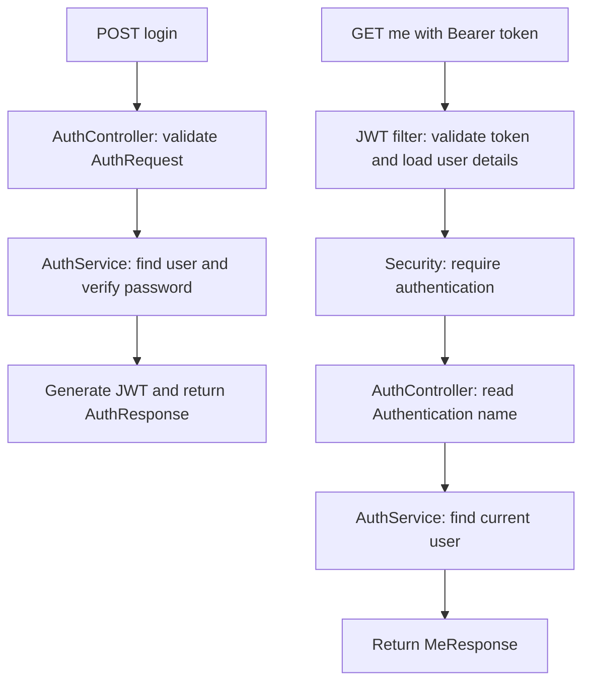

# Auth controller onboarding

[Tiếng Việt](auth-controller.vi.md)

This guide covers login, the current user's identity, and the Bearer token
boundary. See [controller fundamentals](controller-onboarding.md), the
[Product guide](product-controller.md), and the [README](../README.md) for setup.

## Controller and endpoints

Base path: `/api/auth`. Dependency: [AuthService](../src/main/java/com/example/productapi/service/AuthService.java).

| Java method | Endpoint | Input | Success response | Access |
| --- | --- | --- | --- | --- |
| `login()` | `POST /api/auth/login` | JSON `AuthRequest` | `200`, `AuthResponse` | Public |
| `me()` | `GET /api/auth/me` | Current `Authentication` | `200`, `MeResponse` | Authenticated user |

### Login

[AuthRequest](../src/main/java/com/example/productapi/dto/AuthRequest.java) contains
`username` and `password`, both required and nonblank. The controller validates the
request and calls `AuthService.login()`.

The service looks up the user and compares the password using the configured
BCrypt password encoder. Invalid credentials raise `BadCredentialsException`,
mapped to `401`. Successful login generates a JWT and returns
[AuthResponse](../src/main/java/com/example/productapi/dto/AuthResponse.java):

| Field | Meaning |
| --- | --- |
| `token` | Generated JWT |
| `username` | User's username |
| `role` | User's role |
| `expiresIn` | Configured token lifetime in **milliseconds**, obtained from `getExpirationMs()` |

### Current user

`me()` reads `authentication.getName()` and calls
`AuthService.getCurrentUser(username)`. The service retrieves the user from the
repository and returns [MeResponse](../src/main/java/com/example/productapi/dto/MeResponse.java)
with `username` and `role`.

## Request flows



Read `AuthController`, then `AuthService` for the login and current-user paths.
Continue with `JwtAuthenticationFilter` and `SecurityConfig` to understand how
later requests acquire their identity and permissions. The service's user reads
use read-only transactions.

## Security and Bearer tokens

[SecurityConfig](../src/main/java/com/example/productapi/config/SecurityConfig.java)
uses stateless security. `POST /api/auth/login` is public;
`GET /api/auth/me` requires authentication. The password encoder is BCrypt.

[JwtAuthenticationFilter](../src/main/java/com/example/productapi/security/JwtAuthenticationFilter.java)
reads `Authorization: Bearer <token>`, extracts the username, loads user details,
and validates the token before populating the security context. Authorities come
from loaded user details. Failed token processing leaves the request
unauthenticated; protected routes then return `401`. Security handlers can write
errors without entering a controller.

Login returns a token in JSON. Send it as a Bearer header on later requests.
The Auth controller exposes only login and current-user endpoints; no registration,
refresh-token, or logout endpoint is declared here.

## Error responses

[GlobalExceptionHandler](../src/main/java/com/example/productapi/exception/GlobalExceptionHandler.java)
handles validation and service exceptions, while security handlers handle
unauthenticated or forbidden access. Both use
[ErrorResponse](../src/main/java/com/example/productapi/exception/ErrorResponse.java):
`timestamp`, `status`, `error`, `message`, `path`, and `details`.

| Status | Auth API condition |
| --- | --- |
| `400` | Blank/missing username or password, unreadable JSON, or mapped argument type mismatch |
| `401` | Invalid credentials, or unauthenticated access to `/me` |
| `403` | Access denied by authorization, if applicable |
| `500` | Unhandled exception, with the generic message `Internal server error` |

Validation errors include field messages in `details`; the other listed handlers
use an empty map. `getCurrentUser()` throws `UsernameNotFoundException` if its
repository lookup finds no user. The advice has no dedicated mapping for that
exception, so its fallback is `500` if the exception reaches it. Do not infer a
`404` contract for `/me` from product error handling.

## Try the API

Start the app as described in the README. Inside the devcontainer, log in with an
existing account (replace both placeholders):

```sh
curl -i -X POST http://localhost:8080/api/auth/login \
  -H 'Content-Type: application/json' \
  -d '{"username":"<username>","password":"<password>"}'

curl -i http://localhost:8080/api/auth/me \
  -H 'Authorization: Bearer <token>'
```

Successful login returns `200` with `token`, `username`, `role`, and `expiresIn`
in milliseconds. Copy the returned token into the second request; expect `200`
with `username` and `role`. Incorrect credentials or calling `/me` without a
valid token should return `401`. From the host, use the configured host port in
the README. These examples were not executed during documentation work.

## Existing test evidence

[AuthControllerTest](../src/test/java/com/example/productapi/controller/AuthControllerTest.java)
uses standalone MockMvc and a mocked service. It asserts the successful login
response and invalid-credentials mapping. It does not exercise the security
filter chain or `/me`. These are inspected assertions, not test execution results
or proof of full Auth coverage. See the README for test commands.

<!-- spring-docs:verification:start -->
## Verification

- document_status: draft; split into Product and Auth guides at the user's request.
- source_snapshot: committed evidence, `feat/apply-codex-kit` at `5f38de5b897e5f277a1fe114baf56577ed595d6b`; relevant source files match the commit. Documentation edits are uncommitted. Configured default branch is `origin/main`, locally at `392513b603821ab328b2a673aa7a01950d354699`; not freshly fetched. No release or deployment claim.
- code_review: unknown; no review evidence supplied for this snapshot and scope.
- verification_status: complete source comparison within this document's scope and local link checks; runtime behavior unverified.
- code_scope: AuthController; two endpoint contracts, request validation, response DTOs, and current-user binding.
- dependencies: AuthService; AuthRequest, AuthResponse and MeResponse; SecurityConfig; JwtAuthenticationFilter; GlobalExceptionHandler and ErrorResponse; AuthControllerTest; README startup instructions.
- verified_commit: `5f38de5b897e5f277a1fe114baf56577ed595d6b`.
- verified_at: 2026-10-29T22:39:27+07:00.
- content_updated_at: 2026-10-30T07:50:22+07:00.
- verification_limits: inspected source and existing test assertions only; no build, tests, HTTP requests, or Mermaid rendering executed. No separate approved business specification was provided. Vietnamese translation added at the user's request; translation lineage is recorded in the .vi.md sibling.
<!-- spring-docs:verification:end -->
