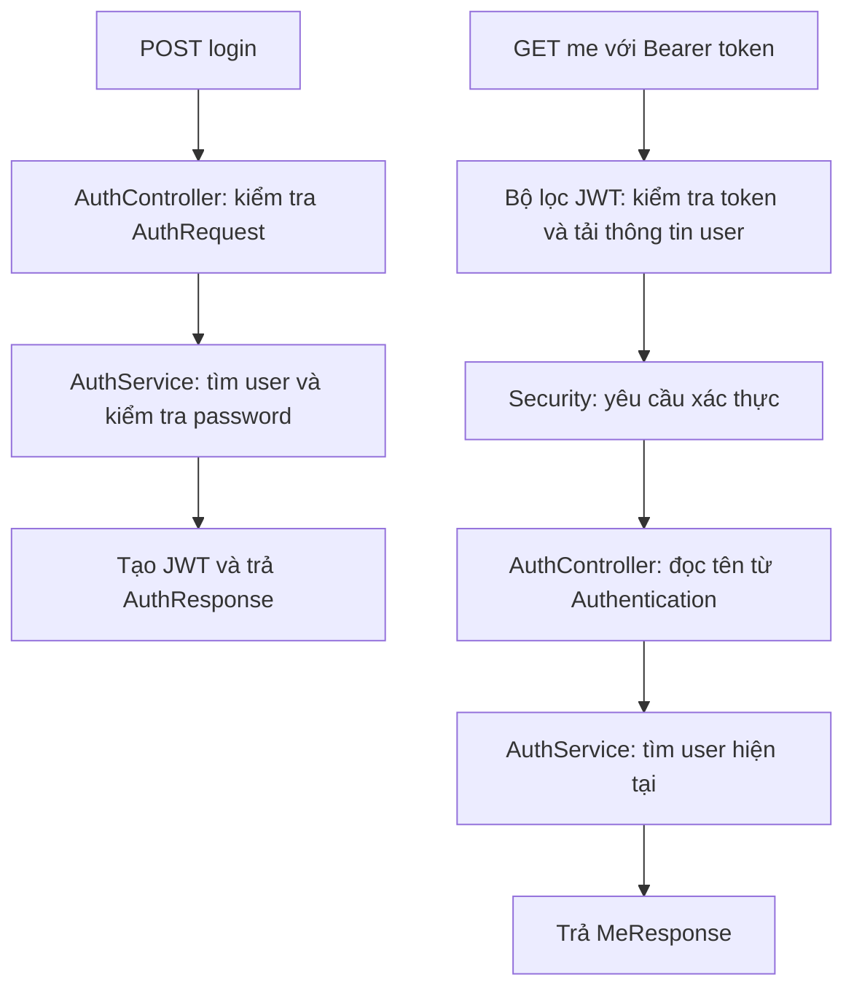

# Onboarding controller Auth

[English](auth-controller.md)

Tài liệu này trình bày đăng nhập, danh tính người dùng hiện tại và xử lý Bearer token. Xem thêm [kiến thức chung về controller](controller-onboarding.vi.md), [Product](product-controller.vi.md) và [README](../README.md) để thiết lập môi trường.

## Controller và endpoint

Đường dẫn gốc: `/api/auth`. Dependency: [AuthService](../src/main/java/com/example/productapi/service/AuthService.java).

| Method Java | Endpoint | Đầu vào | Phản hồi thành công | Quyền truy cập |
| --- | --- | --- | --- | --- |
| `login()` | `POST /api/auth/login` | JSON `AuthRequest` | `200`, `AuthResponse` | Công khai |
| `me()` | `GET /api/auth/me` | `Authentication` hiện tại | `200`, `MeResponse` | Người dùng đã xác thực |

### Đăng nhập

[AuthRequest](../src/main/java/com/example/productapi/dto/AuthRequest.java) có `username` và `password`, cả hai đều bắt buộc và không được rỗng hoặc chỉ có khoảng trắng. Controller kiểm tra request rồi gọi `AuthService.login()`.

Service tìm user và so sánh password bằng bộ mã hóa BCrypt đã cấu hình. Thông tin sai phát sinh `BadCredentialsException`, được ánh xạ thành `401`. Đăng nhập thành công tạo JWT và trả [AuthResponse](../src/main/java/com/example/productapi/dto/AuthResponse.java):

| Field | Ý nghĩa |
| --- | --- |
| `token` | JWT được tạo |
| `username` | Tên đăng nhập của user |
| `role` | Role của user |
| `expiresIn` | Thời hạn token được cấu hình, tính bằng **mili giây**, lấy từ `getExpirationMs()` |

### Người dùng hiện tại

`me()` đọc `authentication.getName()` rồi gọi `AuthService.getCurrentUser(username)`. Service lấy user từ repository và trả [MeResponse](../src/main/java/com/example/productapi/dto/MeResponse.java), gồm `username` và `role`.

## Luồng request



Đọc `AuthController`, sau đó `AuthService` để hiểu đăng nhập và lấy người dùng hiện tại. Tiếp tục với `JwtAuthenticationFilter` và `SecurityConfig` để hiểu cách request tiếp theo có danh tính và quyền. Các thao tác đọc user ở service dùng transaction chỉ đọc.

## Bảo mật và Bearer token

[SecurityConfig](../src/main/java/com/example/productapi/config/SecurityConfig.java) dùng bảo mật stateless. `POST /api/auth/login` công khai; `GET /api/auth/me` yêu cầu xác thực. Bộ mã hóa password là BCrypt.

[JwtAuthenticationFilter](../src/main/java/com/example/productapi/security/JwtAuthenticationFilter.java) đọc `Authorization: Bearer <token>`, lấy username, tải thông tin user và kiểm tra token trước khi thiết lập security context. Quyền được lấy từ thông tin user đã tải. Nếu xử lý token thất bại, request vẫn chưa được xác thực; các đường dẫn được bảo vệ sau đó trả `401`. Bộ xử lý bảo mật có thể ghi phản hồi lỗi trước khi request vào controller.

Đăng nhập trả token trong JSON. Gửi token trong Bearer header ở các request tiếp theo. Auth controller chỉ có đăng nhập và lấy người dùng hiện tại; không khai báo endpoint đăng ký, refresh token hoặc đăng xuất.

## Phản hồi lỗi

[GlobalExceptionHandler](../src/main/java/com/example/productapi/exception/GlobalExceptionHandler.java) xử lý lỗi validation và exception từ service; bộ xử lý bảo mật xử lý truy cập chưa xác thực hoặc bị cấm. Cả hai dùng [ErrorResponse](../src/main/java/com/example/productapi/exception/ErrorResponse.java): `timestamp`, `status`, `error`, `message`, `path`, `details`.

| Status | Trường hợp của API Auth |
| --- | --- |
| `400` | Username/password trống hoặc thiếu, JSON không đọc được, hoặc lỗi kiểu tham số được ánh xạ |
| `401` | Sai thông tin đăng nhập hoặc truy cập `/me` khi chưa xác thực |
| `403` | Bị từ chối bởi kiểm tra quyền, nếu áp dụng |
| `500` | Exception chưa được xử lý riêng, dùng thông báo chung `Internal server error` |

Lỗi validation có thông báo từng field trong `details`; các bộ xử lý còn lại trong bảng dùng map rỗng. `getCurrentUser()` phát sinh `UsernameNotFoundException` nếu repository không tìm thấy user. Advice không có ánh xạ riêng cho exception này nên dùng fallback `500` nếu exception đến được advice. Không suy ra hợp đồng `404` cho `/me` từ xử lý lỗi của Product.

## Thử API

Khởi động ứng dụng theo README. Trong devcontainer, đăng nhập bằng tài khoản đã tồn tại; thay hai giá trị giữ chỗ:

```sh
curl -i -X POST http://localhost:8080/api/auth/login \
  -H 'Content-Type: application/json' \
  -d '{"username":"<username>","password":"<password>"}'

curl -i http://localhost:8080/api/auth/me \
  -H 'Authorization: Bearer <token>'
```

Đăng nhập thành công trả `200` với `token`, `username`, `role`, `expiresIn` tính bằng mili giây. Sao chép token trả về vào request thứ hai; kỳ vọng `200` với `username`, `role`. Sai thông tin đăng nhập hoặc gọi `/me` không có token hợp lệ sẽ trả `401`. Khi gọi từ host, dùng cổng host trong README. Các ví dụ chưa được thực thi trong lần làm tài liệu này.

## Bằng chứng từ test hiện có

[AuthControllerTest](../src/test/java/com/example/productapi/controller/AuthControllerTest.java) dùng MockMvc độc lập và service mock. Test kiểm tra phản hồi đăng nhập thành công và ánh xạ lỗi sai thông tin đăng nhập. Test không chạy security filter chain hoặc `/me`. Đây là các assertion đã đọc, không phải kết quả chạy test hoặc bằng chứng bao phủ toàn bộ Auth. Xem lệnh test trong README.

<!-- spring-docs:verification:start -->
## Xác minh và nguồn bản dịch

- document_status: draft; bản dịch tiếng Việt được người dùng yêu cầu.
- source_document: [auth-controller.md](auth-controller.md).
- source_content_sha256: `6bf12164d8a99e47a43c7b4fe59825bb56e230bb793e73ea1e63433762664637`; SHA-256 nội dung EN UTF-8, chuẩn hóa CRLF thành LF và loại bỏ duy nhất khối metadata được đánh dấu spring-docs:verification, gồm hai dòng marker và ký tự xuống dòng kết thúc.
- translated_at: 2026-10-30T07:50:22+07:00.
- content_updated_at: 2026-10-30T07:50:22+07:00.
- source_snapshot: kế thừa bằng chứng mã nguồn của bản EN tại `feat/apply-codex-kit`, commit `5f38de5b897e5f277a1fe114baf56577ed595d6b`; các file nguồn tham chiếu vẫn khớp commit. Ref mặc định `origin/main` lưu cục bộ tại `392513b603821ab328b2a673aa7a01950d354699`, chưa fetch mới. Tài liệu chưa commit; không khẳng định release hay triển khai.
- code_scope: AuthController; two endpoint contracts, request validation, response DTOs, and current-user binding.
- dependencies: AuthService; AuthRequest, AuthResponse and MeResponse; SecurityConfig; JwtAuthenticationFilter; GlobalExceptionHandler and ErrorResponse; AuthControllerTest; README startup instructions.
- code_review: unknown; chưa có bằng chứng code review cho snapshot và phạm vi này.
- verification_status: bản dịch đã đối chiếu nội dung EN, liên kết/anchor và mã SHA-256; kế thừa đối chiếu mã nguồn của EN, không nâng trạng thái xác minh code chỉ vì dịch.
- verified_commit: `5f38de5b897e5f277a1fe114baf56577ed595d6b`; kế thừa bản EN.
- verified_at: 2026-10-29T22:39:27+07:00; giữ thời điểm đối chiếu code của EN.
- verification_limits: chưa chạy build, test, request HTTP hoặc render Mermaid. Chỉ diễn giải hiện thực trong code; chưa có đặc tả nghiệp vụ được phê duyệt riêng. Bản dịch không xác nhận hành vi runtime.
<!-- spring-docs:verification:end -->
