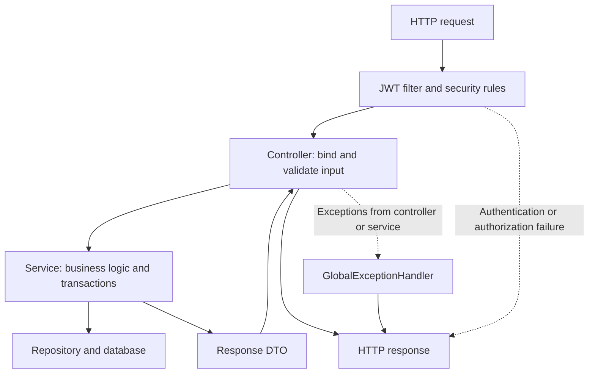

# Controller onboarding

[Tiếng Việt](controller-onboarding.vi.md)

This page introduces the shared controller structure. Detailed onboarding is split
by responsibility:

- [Product controller](product-controller.md): five product endpoints, filtering,
  pagination, sorting, validation, caching boundaries, roles, and errors.
- [Auth controller](auth-controller.md): login, current user, DTOs, JWT authentication,
  and errors.

Read either guide independently, then follow its source links. Start with the
[README](../README.md) for environment setup and application startup.

## Source map and request flow

There are two application controllers, exposing seven endpoints:

| Source | Responsibility |
| --- | --- |
| [AuthController](../src/main/java/com/example/productapi/controller/AuthController.java) | Login and the current user's identity |
| [ProductController](../src/main/java/com/example/productapi/controller/ProductController.java) | Product listing, detail, creation, update, and deletion |
| [package-info.java](../src/main/java/com/example/productapi/controller/package-info.java) | Package comment only; its statement that controllers will be added is outdated |

Actuator health is a framework endpoint, outside these controller classes.

Controllers return DTOs rather than persistence entities. Each controller receives
its service through a constructor and stores it in a `private final` field.

## Anatomy of the controller code

| Element | Meaning in these classes |
| --- | --- |
| `package` and `import` | Locate the class and reference its dependencies |
| `@RestController` | Register an HTTP controller whose return values form response bodies |
| `@RequestMapping` | Set the common path prefix |
| `@GetMapping`, `@PostMapping`, `@PutMapping`, `@DeleteMapping` | Select the HTTP method and optional path suffix |
| `@RequestBody` | Deserialize JSON into a request DTO |
| `@Valid` | Apply the request DTO's validation constraints |
| `@RequestParam` | Bind query parameters, including defaults and optional filters |
| `@PathVariable` | Bind the product ID from the URL |
| `Authentication` | Access the identity supplied by Spring Security |
| `@PreAuthorize` | Check the required role before invoking a method |
| `ResponseEntity<T>` | Specify response status, headers, and body |

## Shared boundaries

Validation and error mapping are detailed in each domain guide. Both use
[GlobalExceptionHandler](../src/main/java/com/example/productapi/exception/GlobalExceptionHandler.java)
and [ErrorResponse](../src/main/java/com/example/productapi/exception/ErrorResponse.java).
`@RestControllerAdvice` handles exceptions and does not declare additional API
endpoints. Security handlers may respond before controller execution.

For a first walkthrough, start with [Product listing](product-controller.md#listing-filtering-and-pagination).
For authentication prerequisites, start with [Auth login](auth-controller.md#login).

<!-- spring-docs:verification:start -->
## Verification

- document_status: draft; split into Product and Auth guides at the user's request.
- source_snapshot: committed evidence, `feat/apply-codex-kit` at `5f38de5b897e5f277a1fe114baf56577ed595d6b`; relevant source files match the commit. Documentation edits are uncommitted. Configured default branch is `origin/main`, locally at `392513b603821ab328b2a673aa7a01950d354699`; not freshly fetched. No release or deployment claim.
- code_review: unknown; no review evidence supplied for this snapshot and scope.
- verification_status: complete source comparison within this document's scope and local link checks; runtime behavior unverified.
- code_scope: Both controller classes and package-info.java; source map, shared annotations, and request flow.
- dependencies: GlobalExceptionHandler; ErrorResponse; SecurityConfig; both domain onboarding guides; README startup instructions.
- verified_commit: `5f38de5b897e5f277a1fe114baf56577ed595d6b`.
- verified_at: 2026-10-29T22:39:27+07:00.
- content_updated_at: 2026-10-30T07:50:22+07:00.
- verification_limits: inspected source and existing test assertions only; no build, tests, HTTP requests, or Mermaid rendering executed. No separate approved business specification was provided. Vietnamese translation added at the user's request; translation lineage is recorded in the .vi.md sibling.
<!-- spring-docs:verification:end -->
