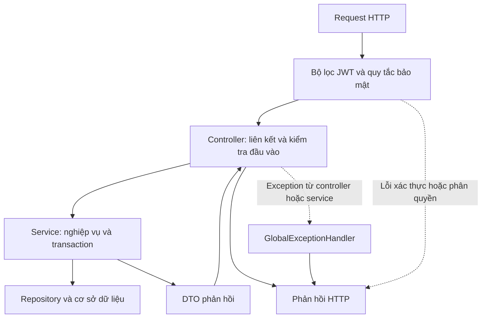

# Onboarding controller

[English](controller-onboarding.md)

Trang này giới thiệu cấu trúc chung của controller. Nội dung chi tiết được tách theo trách nhiệm:

- [Controller Product](product-controller.vi.md): năm endpoint sản phẩm, lọc, phân trang, sắp xếp, validation, cache, quyền và lỗi.
- [Controller Auth](auth-controller.vi.md): đăng nhập, người dùng hiện tại, DTO, xác thực JWT và lỗi.

Bạn có thể đọc riêng từng tài liệu, rồi lần theo các liên kết mã nguồn. Xem [README](../README.md) để thiết lập môi trường và khởi động ứng dụng.

## Bản đồ mã nguồn và luồng request

Có hai controller của ứng dụng, cung cấp tổng cộng bảy endpoint:

| Mã nguồn | Trách nhiệm |
| --- | --- |
| [AuthController](../src/main/java/com/example/productapi/controller/AuthController.java) | Đăng nhập và danh tính người dùng hiện tại |
| [ProductController](../src/main/java/com/example/productapi/controller/ProductController.java) | Danh sách, chi tiết, tạo, cập nhật và xóa sản phẩm |
| [package-info.java](../src/main/java/com/example/productapi/controller/package-info.java) | Chỉ có comment mô tả package; nội dung nói rằng controller sẽ được thêm vào đã lỗi thời |

Health của Actuator là endpoint do framework cung cấp, nằm ngoài hai lớp controller này.

Controller trả DTO thay vì entity lưu trữ. Mỗi controller nhận service qua constructor và lưu vào field `private final`.

## Các thành phần trong controller

| Thành phần | Ý nghĩa trong các lớp này |
| --- | --- |
| `package` và `import` | Xác định vị trí lớp và tham chiếu các dependency |
| `@RestController` | Đăng ký controller HTTP có giá trị trả về làm response body |
| `@RequestMapping` | Đặt tiền tố đường dẫn chung |
| `@GetMapping`, `@PostMapping`, `@PutMapping`, `@DeleteMapping` | Chọn HTTP method và phần đường dẫn bổ sung nếu có |
| `@RequestBody` | Chuyển JSON thành DTO đầu vào |
| `@Valid` | Áp dụng các ràng buộc validation của DTO |
| `@RequestParam` | Đọc query parameter, gồm giá trị mặc định và bộ lọc tùy chọn |
| `@PathVariable` | Đọc ID sản phẩm từ URL |
| `Authentication` | Truy cập danh tính do Spring Security cung cấp |
| `@PreAuthorize` | Kiểm tra role trước khi gọi method |
| `ResponseEntity<T>` | Chỉ định status, header và body của phản hồi |

## Các phần xử lý chung

Validation và ánh xạ lỗi được giải thích trong từng tài liệu. Cả hai dùng [GlobalExceptionHandler](../src/main/java/com/example/productapi/exception/GlobalExceptionHandler.java) và [ErrorResponse](../src/main/java/com/example/productapi/exception/ErrorResponse.java).
`@RestControllerAdvice` xử lý exception, không khai báo thêm endpoint API. Bộ xử lý bảo mật có thể trả phản hồi trước khi controller thực thi.

Để bắt đầu lần theo mã nguồn, đọc [danh sách sản phẩm](product-controller.vi.md#danh-sách-lọc-và-phân-trang). Để hiểu điều kiện xác thực, đọc [đăng nhập](auth-controller.vi.md#đăng-nhập).

<!-- spring-docs:verification:start -->
## Xác minh và nguồn bản dịch

- document_status: draft; bản dịch tiếng Việt được người dùng yêu cầu.
- source_document: [controller-onboarding.md](controller-onboarding.md).
- source_content_sha256: `78b5092cd1829a4063934df4950105726e7e8169b4ec31a9ae2b0278e4fac551`; SHA-256 nội dung EN UTF-8, chuẩn hóa CRLF thành LF và loại bỏ duy nhất khối metadata được đánh dấu spring-docs:verification, gồm hai dòng marker và ký tự xuống dòng kết thúc.
- translated_at: 2026-10-30T07:50:22+07:00.
- content_updated_at: 2026-10-30T07:50:22+07:00.
- source_snapshot: kế thừa bằng chứng mã nguồn của bản EN tại `feat/apply-codex-kit`, commit `5f38de5b897e5f277a1fe114baf56577ed595d6b`; các file nguồn tham chiếu vẫn khớp commit. Ref mặc định `origin/main` lưu cục bộ tại `392513b603821ab328b2a673aa7a01950d354699`, chưa fetch mới. Tài liệu chưa commit; không khẳng định release hay triển khai.
- code_scope: Both controller classes and package-info.java; source map, shared annotations, and request flow.
- dependencies: GlobalExceptionHandler; ErrorResponse; SecurityConfig; both domain onboarding guides; README startup instructions.
- code_review: unknown; chưa có bằng chứng code review cho snapshot và phạm vi này.
- verification_status: bản dịch đã đối chiếu nội dung EN, liên kết/anchor và mã SHA-256; kế thừa đối chiếu mã nguồn của EN, không nâng trạng thái xác minh code chỉ vì dịch.
- verified_commit: `5f38de5b897e5f277a1fe114baf56577ed595d6b`; kế thừa bản EN.
- verified_at: 2026-10-29T22:39:27+07:00; giữ thời điểm đối chiếu code của EN.
- verification_limits: chưa chạy build, test, request HTTP hoặc render Mermaid. Chỉ diễn giải hiện thực trong code; chưa có đặc tả nghiệp vụ được phê duyệt riêng. Bản dịch không xác nhận hành vi runtime.
<!-- spring-docs:verification:end -->
