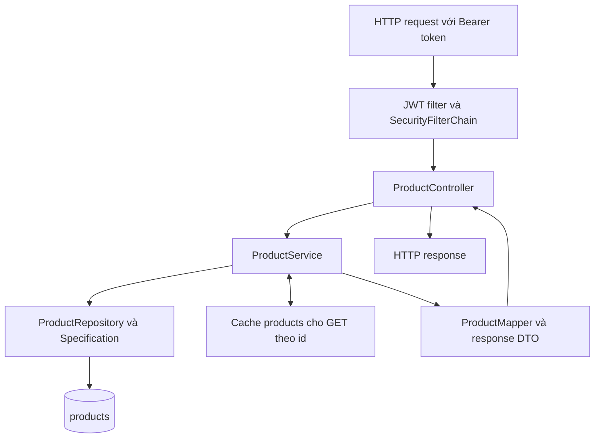

# Tổng quan Product

## Trách nhiệm và phạm vi

`ProductController` cung cấp CRUD và tìm kiếm sản phẩm tại `/api/products`, trả DTO qua `ResponseEntity` ([ProductController](../../../src/main/java/com/example/productapi/controller/ProductController.java#L28)). Tài liệu bao phủ năm thao tác dưới đây và phụ thuộc cần thiết để giải thích chúng.

| Chức năng | Tài liệu |
|---|---|
| Danh sách, lọc, phân trang, sắp xếp | [List products](features/list-products.md) |
| Chi tiết theo id, dùng cache DTO | [Get product](features/get-product.md) |
| Tạo sản phẩm | [Create product](features/create-product.md) |
| Thay thế thông tin sản phẩm | [Update product](features/update-product.md) |
| Xóa sản phẩm | [Delete product](features/delete-product.md) |

## Thành phần và luồng chung

Controller chuyển query/body thành DTO và gọi service; service giữ transaction, gọi repository và mapper ([ProductController.getAll](../../../src/main/java/com/example/productapi/controller/ProductController.java#L40), [ProductService.getAll](../../../src/main/java/com/example/productapi/service/ProductService.java#L30)). Repository hỗ trợ JPA và Specification ([ProductRepository](../../../src/main/java/com/example/productapi/repository/ProductRepository.java#L7)). Xem [API](api.md) và [mô hình dữ liệu](data-model.md).

## Quan hệ và tác động chung

- Security kiểm tra JWT trước controller. GET cho `ADMIN`/`USER`; ghi yêu cầu `ADMIN`. Xem [SecurityConfig.securityFilterChain](../../../src/main/java/com/example/productapi/config/SecurityConfig.java#L38) và [JwtAuthenticationFilter.doFilterInternal](../../../src/main/java/com/example/productapi/security/JwtAuthenticationFilter.java#L29). Auth chỉ được đề cập như phụ thuộc; hướng dẫn login tại [README](../../../README.md).
- `getAll` và cache miss của `getById` dùng transaction read-only; create/update/delete dùng transaction ghi. Không thấy lời gọi dịch vụ ngoài, job hoặc event nghiệp vụ trong các phương thức service đã khảo sát ([ProductService](../../../src/main/java/com/example/productapi/service/ProductService.java#L19)).
- Cache nội bộ lưu `ProductResponse` theo id, không cache danh sách; ghi thành công xóa toàn bộ cache `products` sau commit. Rollback không áp dụng eviction đã trì hoãn ([ProductService.@Cacheable](../../../src/main/java/com/example/productapi/service/ProductService.java#L36), [CacheConfig.cacheManager](../../../src/main/java/com/example/productapi/config/CacheConfig.java#L15)). Cache không có TTL cấu hình và không chia sẻ giữa các instance.
- Lỗi nghiệp vụ/validation được đổi thành JSON; optimistic conflict trả 409 ([GlobalExceptionHandler](../../../src/main/java/com/example/productapi/exception/GlobalExceptionHandler.java#L21)). Tài liệu ghi hành vi triển khai; không có tài liệu yêu cầu nghiệp vụ độc lập để xác nhận ý định ngoài code.

<!-- spring-docs:verification:start -->
## Ghi nhận đối chiếu

- `document_status`: draft.
- `source_snapshot`: commit `92d4ff87e67f2a90bff2e379f4a6af71c4d1d621`; đối chiếu mã nguồn sạch tại thời điểm 2026-11-12T10:24:16+00:00. Các file tài liệu mới chưa commit không thuộc snapshot code này.
- `code_scope`: Năm endpoint của ProductController và các lớp trực tiếp tham gia luồng.
- `dependencies`: security/JWT, DTO, service, mapper, repository/specification, entity, cache, xử lý lỗi và migration liên quan đến Product.
- `code_review`: unknown; chưa có bằng chứng review cho snapshot này.
- `verification_status`: complete trong phạm vi đối chiếu mã nguồn; kiểm tra liên kết cục bộ. Không xác nhận hành vi runtime.
- `verified_commit`: `92d4ff87e67f2a90bff2e379f4a6af71c4d1d621`.
- `verified_at`: 2026-11-12T10:24:16+00:00.
- `content_updated_at`: 2026-11-12T10:24:16+00:00.
- `verification_limits`: chưa chạy Maven, ứng dụng, HTTP request hay render Mermaid; test được dẫn là mã test đã có, không phải kết quả chạy.
<!-- spring-docs:verification:end -->
