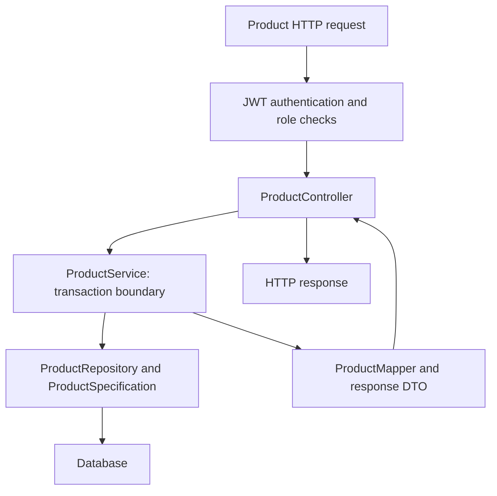

# Product controller onboarding

[Tiếng Việt](product-controller.vi.md)

This guide covers product listing, detail, creation, update, and deletion.
See [controller fundamentals](controller-onboarding.md) for annotation meanings,
[Auth](auth-controller.md) for obtaining a token, and the [README](../README.md)
for application startup and host ports.

## Controller and endpoints

Base path: `/api/products`. Dependency: [ProductService](../src/main/java/com/example/productapi/service/ProductService.java).

| Java method | Endpoint | Success response | Access |
| --- | --- | --- | --- |
| `getAll()` | `GET /api/products` | `200`, `PageResponse<ProductResponse>` | `USER` or `ADMIN` |
| `getById()` | `GET /api/products/{id}` | `200`, `ProductResponse` | `USER` or `ADMIN` |
| `create()` | `POST /api/products` | `201`, `ProductResponse` and `Location` header | `ADMIN` |
| `update()` | `PUT /api/products/{id}` | `200`, `ProductResponse` | `ADMIN` |
| `delete()` | `DELETE /api/products/{id}` | `204`, no response body | `ADMIN` |

### Listing, filtering, and pagination

`getAll()` accepts these query parameters:

| Parameter | Java type | Default | Behavior |
| --- | --- | --- | --- |
| `page` | `int` | `0` | Zero-based page number; must be nonnegative |
| `size` | `int` | `10` | Page size, from 1 to 100 |
| `sort` | `String` | `createdAt,desc` | One field and direction separated by a comma |
| `name` | `String` | Absent | Trimmed, case-insensitive substring match; blank adds no restriction |
| `minPrice` | `BigDecimal` | Absent | Inclusive minimum price |
| `maxPrice` | `BigDecimal` | Absent | Inclusive maximum price |
| `inStock` | `Boolean` | Absent | `true`: stock > 0; `false`: stock = 0; absent: no stock restriction |

The controller checks pagination bounds, builds a
[ProductFilter](../src/main/java/com/example/productapi/dto/ProductFilter.java) and
`PageRequest`, then calls the service. The service builds a
[ProductSpecification](../src/main/java/com/example/productapi/repository/spec/ProductSpecification.java)
and queries the repository. Filter predicates are combined with AND. Price bounds
cannot be negative, and the minimum cannot exceed the maximum; violations produce
`400`. Name matching treats `%` and `_` as literal characters through escaping.

The result is converted into [PageResponse](../src/main/java/com/example/productapi/dto/PageResponse.java),
containing `content`, `page`, `size`, `totalElements`, and `totalPages`.

### Sort helper and allowed fields

`SORT_FIELDS` permits `id`, `name`, `price`, `stock`, `createdAt`, and `updatedAt`.
The private `parseSort()` helper requires exactly a field and an `asc` or `desc`
direction, trimming both parts. Unsupported fields or invalid formats/directions
raise `BusinessException` and produce `400`.

Unless the selected field is `id`, the helper appends `id ASC` as a tie breaker.
For example, `sort=price,asc` becomes `price ASC, id ASC`. `parseSort()` is an
internal helper, with no endpoint of its own.

### Detail, create, update, and delete

- `getById()` delegates to the service, which caches `ProductResponse` by ID.
- `create()` validates the body, saves the product, and returns `201` with a
  relative `Location` header of `/api/products/{newId}`.
- `update()` validates the body and updates all four request fields through
  [ProductMapper](../src/main/java/com/example/productapi/mapper/ProductMapper.java).
  An omitted `description` becomes null; this is a full request DTO update.
- `delete()` delegates deletion to the service and returns an empty `204` response.

Detail, update, and delete raise `ResourceNotFoundException` when the product does
not exist, producing `404`. There is no `PATCH` endpoint in these controllers.
Transactions belong to the service. Product writes evict the product cache;
[CacheConfig](../src/main/java/com/example/productapi/config/CacheConfig.java) defers
cache mutations until commit. List responses are not cached by this service.

### Product request and response DTOs

Create and update share [ProductRequest](../src/main/java/com/example/productapi/dto/ProductRequest.java):

| Field | Validation |
| --- | --- |
| `name` | Nonblank, at most 255 characters |
| `description` | No Bean Validation constraint; may be null |
| `price` | Required, greater than zero, at most 10 integer digits and 2 fractional digits |
| `stock` | Required integer, at least zero |

[ProductResponse](../src/main/java/com/example/productapi/dto/ProductResponse.java)
contains `id`, `name`, `description`, `price`, `stock`, `createdAt`, and `updatedAt`.

## Request flow



Read `ProductController.getAll()`, then `ProductService.getAll()` and
`ProductSpecification.build()` to follow pagination and filtering. Read
`ProductRequest` and `ProductMapper` next for write validation and field mapping.
The detail method may return a cached DTO without querying the database.

## Security

[SecurityConfig](../src/main/java/com/example/productapi/config/SecurityConfig.java)
requires `USER` or `ADMIN` for product reads and `ADMIN` for writes. The three
write methods also declare `@PreAuthorize("hasRole('ADMIN')")`; method security is
enabled in the configuration. Authentication uses the Bearer JWT flow described
in the [Auth guide](auth-controller.md#security-and-bearer-tokens).

## Error responses

[GlobalExceptionHandler](../src/main/java/com/example/productapi/exception/GlobalExceptionHandler.java)
maps controller/service exceptions. Security handlers can return errors before
controller execution. The common
[ErrorResponse](../src/main/java/com/example/productapi/exception/ErrorResponse.java)
contains `timestamp`, `status`, `error`, `message`, `path`, and `details`.

| Status | Product API condition |
| --- | --- |
| `400` | Invalid request DTO, JSON or argument type; invalid pagination, sort, or price bounds |
| `401` | Authentication required; missing, invalid, or expired token |
| `403` | Authenticated user lacks the required role |
| `404` | Product not found during detail, update, or delete |
| `409` | Optimistic locking conflict; reload and retry |
| `500` | Unhandled exception, with the generic message `Internal server error` |

Validation errors include field messages in `details`; the other listed handlers
use an empty map. Optimistic locking does not establish detection of every stale
client form: the update request carries no client version.

## Try the API

After starting the app using the README, take a token from a successful login.
Inside the devcontainer, an illustrative request is:

```sh
curl -i 'http://localhost:8080/api/products?page=0&size=10&sort=price,asc&name=phone&inStock=true' \
  -H 'Authorization: Bearer <token>'
```

With a valid `USER` or `ADMIN` token, expect `200` and the pagination fields above;
`content` can be empty. Without authentication, expect `401`. With a valid token
and `size=101`, expect `400`. From the host, use the configured host port described
in the README. These requests were not executed during documentation work.

## Existing test evidence

[ProductControllerTest](../src/test/java/com/example/productapi/controller/ProductControllerTest.java)
uses `@WebMvcTest`, imported security configuration, and mocked services. It
asserts missing authentication, optimistic conflict mapping, default pagination
and stable sort, and invalid size/sort inputs. These are inspected assertions,
not execution results or proof of full endpoint coverage. See the README for
test commands.

<!-- spring-docs:verification:start -->
## Verification

- document_status: draft; split into Product and Auth guides at the user's request.
- source_snapshot: committed evidence, `feat/apply-codex-kit` at `5f38de5b897e5f277a1fe114baf56577ed595d6b`; relevant source files match the commit. Documentation edits are uncommitted. Configured default branch is `origin/main`, locally at `392513b603821ab328b2a673aa7a01950d354699`; not freshly fetched. No release or deployment claim.
- code_review: unknown; no review evidence supplied for this snapshot and scope.
- verification_status: complete source comparison within this document's scope and local link checks; runtime behavior unverified.
- code_scope: ProductController; five endpoint contracts, request binding, validation, and sort helper.
- dependencies: ProductService; ProductMapper; ProductSpecification; product/filter/page DTOs; SecurityConfig; JwtAuthenticationFilter; CacheConfig; GlobalExceptionHandler and ErrorResponse; ProductControllerTest; README startup instructions.
- verified_commit: `5f38de5b897e5f277a1fe114baf56577ed595d6b`.
- verified_at: 2026-10-29T22:39:27+07:00.
- content_updated_at: 2026-10-30T07:50:22+07:00.
- verification_limits: inspected source and existing test assertions only; no build, tests, HTTP requests, or Mermaid rendering executed. No separate approved business specification was provided. Vietnamese translation added at the user's request; translation lineage is recorded in the .vi.md sibling.
<!-- spring-docs:verification:end -->
