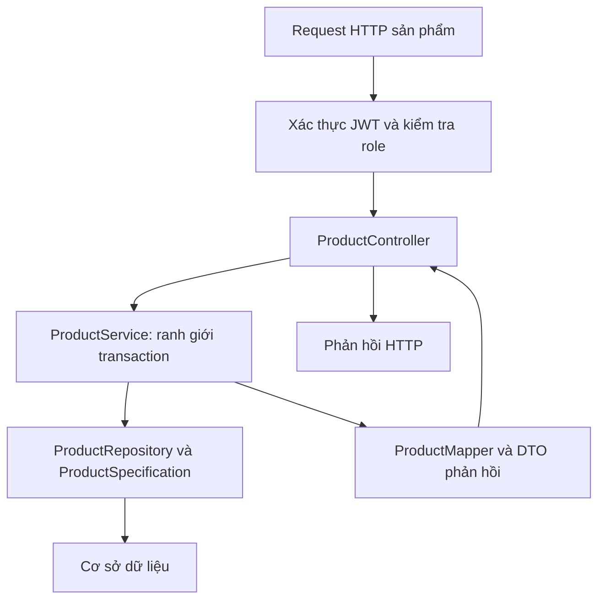

# Onboarding controller Product

[English](product-controller.md)

Tài liệu này trình bày danh sách, chi tiết, tạo, cập nhật và xóa sản phẩm. Xem [kiến thức chung về controller](controller-onboarding.vi.md) để hiểu annotation, [Auth](auth-controller.vi.md) để lấy token và [README](../README.md) để khởi động ứng dụng, tra cổng host.

## Controller và endpoint

Đường dẫn gốc: `/api/products`. Dependency: [ProductService](../src/main/java/com/example/productapi/service/ProductService.java).

| Method Java | Endpoint | Phản hồi thành công | Quyền truy cập |
| --- | --- | --- | --- |
| `getAll()` | `GET /api/products` | `200`, `PageResponse<ProductResponse>` | `USER` hoặc `ADMIN` |
| `getById()` | `GET /api/products/{id}` | `200`, `ProductResponse` | `USER` hoặc `ADMIN` |
| `create()` | `POST /api/products` | `201`, `ProductResponse` và header `Location` | `ADMIN` |
| `update()` | `PUT /api/products/{id}` | `200`, `ProductResponse` | `ADMIN` |
| `delete()` | `DELETE /api/products/{id}` | `204`, không có response body | `ADMIN` |

### Danh sách, lọc và phân trang

`getAll()` nhận các query parameter:

| Tham số | Kiểu Java | Mặc định | Hành vi |
| --- | --- | --- | --- |
| `page` | `int` | `0` | Số trang bắt đầu từ 0; không được âm |
| `size` | `int` | `10` | Kích thước trang, từ 1 đến 100 |
| `sort` | `String` | `createdAt,desc` | Một field và chiều sắp xếp, ngăn bằng dấu phẩy |
| `name` | `String` | Không truyền | Bỏ khoảng trắng đầu/cuối, tìm chuỗi con không phân biệt hoa thường; chuỗi trống không thêm điều kiện |
| `minPrice` | `BigDecimal` | Không truyền | Giá tối thiểu, bao gồm giá bằng cận |
| `maxPrice` | `BigDecimal` | Không truyền | Giá tối đa, bao gồm giá bằng cận |
| `inStock` | `Boolean` | Không truyền | `true`: stock > 0; `false`: stock = 0; không truyền: không lọc stock |

Controller kiểm tra giới hạn phân trang, tạo [ProductFilter](../src/main/java/com/example/productapi/dto/ProductFilter.java) và `PageRequest`, rồi gọi service. Service tạo [ProductSpecification](../src/main/java/com/example/productapi/repository/spec/ProductSpecification.java) và truy vấn repository. Các điều kiện lọc kết hợp bằng AND. Cận giá không được âm, giá tối thiểu không được lớn hơn tối đa; vi phạm trả `400`. Khi tìm tên, `%` và `_` được escape để coi là ký tự thông thường.

Kết quả được chuyển thành [PageResponse](../src/main/java/com/example/productapi/dto/PageResponse.java), gồm `content`, `page`, `size`, `totalElements`, `totalPages`.

### Hàm hỗ trợ sort và các field cho phép

`SORT_FIELDS` cho phép `id`, `name`, `price`, `stock`, `createdAt`, `updatedAt`. Hàm private `parseSort()` yêu cầu đúng một field và chiều `asc` hoặc `desc`, bỏ khoảng trắng đầu/cuối ở cả hai phần. Field không hỗ trợ hoặc định dạng/chiều không hợp lệ phát sinh `BusinessException` và trả `400`.

Nếu field được chọn khác `id`, hàm thêm `id ASC` để phân định thứ tự khi giá trị chính bằng nhau. Ví dụ `sort=price,asc` trở thành `price ASC, id ASC`. `parseSort()` là hàm nội bộ, không có endpoint riêng.

### Chi tiết, tạo, cập nhật và xóa

- `getById()` gọi service; service cache `ProductResponse` theo ID.
- `create()` kiểm tra body, lưu sản phẩm và trả `201`, kèm header `Location` tương đối là `/api/products/{newId}`.
- `update()` kiểm tra body và cập nhật cả bốn field qua [ProductMapper](../src/main/java/com/example/productapi/mapper/ProductMapper.java). Nếu không truyền `description`, giá trị trở thành null; đây là cập nhật toàn bộ DTO đầu vào.
- `delete()` giao việc xóa cho service và trả `204` không có body.

Chi tiết, cập nhật và xóa phát sinh `ResourceNotFoundException` khi sản phẩm không tồn tại, trả `404`. Các controller này không có endpoint `PATCH`. Transaction nằm ở service. Thao tác ghi sản phẩm xóa cache; [CacheConfig](../src/main/java/com/example/productapi/config/CacheConfig.java) hoãn thay đổi cache đến khi commit. Service không cache kết quả danh sách.

### DTO đầu vào và đầu ra của sản phẩm

Tạo và cập nhật cùng dùng [ProductRequest](../src/main/java/com/example/productapi/dto/ProductRequest.java):

| Field | Validation |
| --- | --- |
| `name` | Không rỗng hoặc chỉ có khoảng trắng; tối đa 255 ký tự |
| `description` | Không có ràng buộc Bean Validation; có thể null |
| `price` | Bắt buộc, lớn hơn 0, tối đa 10 chữ số phần nguyên và 2 chữ số thập phân |
| `stock` | Số nguyên bắt buộc, không âm |

[ProductResponse](../src/main/java/com/example/productapi/dto/ProductResponse.java) gồm `id`, `name`, `description`, `price`, `stock`, `createdAt`, `updatedAt`.

## Luồng request



Đọc `ProductController.getAll()`, sau đó `ProductService.getAll()` và `ProductSpecification.build()` để lần theo phân trang, lọc dữ liệu. Tiếp tục với `ProductRequest`, `ProductMapper` để hiểu validation khi ghi và ánh xạ field. Method lấy chi tiết có thể trả DTO từ cache mà không truy vấn cơ sở dữ liệu.

## Bảo mật

[SecurityConfig](../src/main/java/com/example/productapi/config/SecurityConfig.java) yêu cầu `USER` hoặc `ADMIN` cho thao tác đọc và `ADMIN` cho thao tác ghi. Ba method ghi còn khai báo `@PreAuthorize("hasRole('ADMIN')")`; cấu hình đã bật method security. Xác thực dùng luồng Bearer JWT trong [tài liệu Auth](auth-controller.vi.md#bảo-mật-và-bearer-token).

## Phản hồi lỗi

[GlobalExceptionHandler](../src/main/java/com/example/productapi/exception/GlobalExceptionHandler.java) ánh xạ exception từ controller/service. Bộ xử lý bảo mật có thể trả lỗi trước khi controller chạy. [ErrorResponse](../src/main/java/com/example/productapi/exception/ErrorResponse.java) dùng chung gồm `timestamp`, `status`, `error`, `message`, `path`, `details`.

| Status | Trường hợp của API Product |
| --- | --- |
| `400` | DTO đầu vào, JSON hoặc kiểu tham số sai; phân trang, sort hoặc cận giá không hợp lệ |
| `401` | Cần xác thực; token thiếu, không hợp lệ hoặc hết hạn |
| `403` | Người dùng đã xác thực nhưng không đủ role |
| `404` | Không tìm thấy sản phẩm khi lấy chi tiết, cập nhật hoặc xóa |
| `409` | Xung đột optimistic locking; tải lại rồi thử lại |
| `500` | Exception chưa được xử lý riêng, dùng thông báo chung `Internal server error` |

Lỗi validation có thông báo từng field trong `details`; các bộ xử lý còn lại trong bảng dùng map rỗng. Optimistic locking không chứng minh mọi form cũ đều được phát hiện: request cập nhật không mang version của client.

## Thử API

Sau khi khởi động theo README, lấy token từ lần đăng nhập thành công. Trong devcontainer, ví dụ request:

```sh
curl -i 'http://localhost:8080/api/products?page=0&size=10&sort=price,asc&name=phone&inStock=true' \
  -H 'Authorization: Bearer <token>'
```

Với token hợp lệ của `USER` hoặc `ADMIN`, kỳ vọng `200` và các field phân trang đã nêu; `content` có thể rỗng. Không xác thực thì kỳ vọng `401`. Token hợp lệ nhưng `size=101` thì kỳ vọng `400`. Khi gọi từ host, dùng cổng host trong README. Các request chưa được thực thi trong lần làm tài liệu này.

## Bằng chứng từ test hiện có

[ProductControllerTest](../src/test/java/com/example/productapi/controller/ProductControllerTest.java) dùng `@WebMvcTest`, import cấu hình bảo mật và service mock. Test kiểm tra thiếu xác thực, ánh xạ xung đột optimistic locking, phân trang mặc định và sort ổn định, đầu vào size/sort sai. Đây là các assertion đã đọc, không phải kết quả chạy test hoặc bằng chứng bao phủ toàn bộ endpoint. Xem lệnh test trong README.

<!-- spring-docs:verification:start -->
## Xác minh và nguồn bản dịch

- document_status: draft; bản dịch tiếng Việt được người dùng yêu cầu.
- source_document: [product-controller.md](product-controller.md).
- source_content_sha256: `35257416e021168d89d7e90caf74e9b1b93e9303830f5055e499ec26e833e5a2`; SHA-256 nội dung EN UTF-8, chuẩn hóa CRLF thành LF và loại bỏ duy nhất khối metadata được đánh dấu spring-docs:verification, gồm hai dòng marker và ký tự xuống dòng kết thúc.
- translated_at: 2026-10-30T07:50:22+07:00.
- content_updated_at: 2026-10-30T07:50:22+07:00.
- source_snapshot: kế thừa bằng chứng mã nguồn của bản EN tại `feat/apply-codex-kit`, commit `5f38de5b897e5f277a1fe114baf56577ed595d6b`; các file nguồn tham chiếu vẫn khớp commit. Ref mặc định `origin/main` lưu cục bộ tại `392513b603821ab328b2a673aa7a01950d354699`, chưa fetch mới. Tài liệu chưa commit; không khẳng định release hay triển khai.
- code_scope: ProductController; five endpoint contracts, request binding, validation, and sort helper.
- dependencies: ProductService; ProductMapper; ProductSpecification; product/filter/page DTOs; SecurityConfig; JwtAuthenticationFilter; CacheConfig; GlobalExceptionHandler and ErrorResponse; ProductControllerTest; README startup instructions.
- code_review: unknown; chưa có bằng chứng code review cho snapshot và phạm vi này.
- verification_status: bản dịch đã đối chiếu nội dung EN, liên kết/anchor và mã SHA-256; kế thừa đối chiếu mã nguồn của EN, không nâng trạng thái xác minh code chỉ vì dịch.
- verified_commit: `5f38de5b897e5f277a1fe114baf56577ed595d6b`; kế thừa bản EN.
- verified_at: 2026-10-29T22:39:27+07:00; giữ thời điểm đối chiếu code của EN.
- verification_limits: chưa chạy build, test, request HTTP hoặc render Mermaid. Chỉ diễn giải hiện thực trong code; chưa có đặc tả nghiệp vụ được phê duyệt riêng. Bản dịch không xác nhận hành vi runtime.
<!-- spring-docs:verification:end -->
